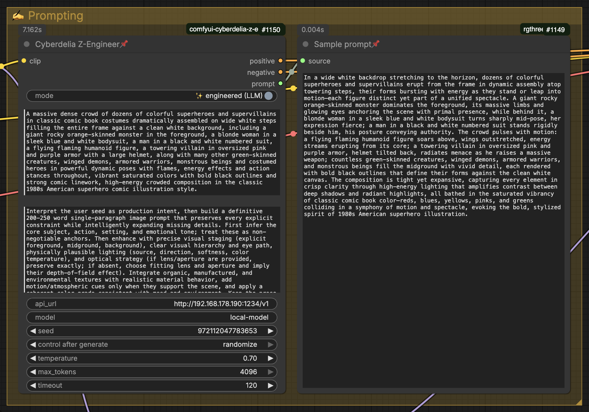

# Cyberdelia Prompt Engineer

<p align="center">
  
</p>

[](https://github.com/cyberdeliaAI/comfyui-cyberdelia-z-engineer/actions/workflows/tests.yml)
[](LICENSE)

Model-independent text, vision, wildcard, and Danbooru prompt engineering for ComfyUI. Generate a reusable prompt string, filled prompt templates, validated anime tags, or CLIP-encoded sampler-ready conditioning.

The package and repository retain the legacy name `comfyui-cyberdelia-z-engineer` so existing installations and update paths remain compatible.

By **Cyberdelia AI Lab** · [github.com/cyberdeliaAI](https://github.com/cyberdeliaAI)

---



## What it does

Cyberdelia Prompt Engineer sends text, or an optional image plus instructions, to LM Studio, Ollama, or another OpenAI-compatible server. Its prompt nodes share the same generation pipeline:

| Node | CLIP required | Outputs | Best for |
| --- | --- | --- | --- |
| **Prompt Engineer — Text** | No | Prompt `STRING` | Krea2, Flux, external encoders, metadata, image-to-prompt |
| **Prompt Engineer — Conditioning** | Yes | Positive, negative, prompt | Workflows that use normal CLIP conditioning directly |
| **Prompt Engineer — Chain** | No | Final prompt plus five stage previews | Applying multiple system prompts sequentially |
| **Danbooru Prompt** | No | Prompt, tags, dropped tags | Anime checkpoints trained on booru-style captions |
| **Wildcard Prompts** | No | Prompts, preview, prompt count | LoRA testing with editable templates and random or sequential prompts |

Existing workflows can bypass the LLM with the built-in passthrough toggle.

The separate **Cyberdelia Danbooru Prompt** node converts a normal scene description into real Danbooru tags, validates them against a bundled local vocabulary, and optionally wraps them in an editable prompt template.

## Release 1.11.0

- Improve sequential wildcard handling for promoted subgraph inputs, shared instances, partial runs and shared Primitive counters. Preserve active Primitive controls and advance each shared source once per submission.
- Show sequential progress and an end-of-list notice with a reset action. Evaluate a connected `fallback_prompt` only while wildcards are off.
- Support nested choice groups and full-line prompt comments; warn about undefined tags and clean spacing/commas after removals.
- Restrict server-side `prompt_file` reads to ComfyUI/input or folders in `CYBERDELIA_Z_ENGINEER_PROMPT_DIRS`, with a 10 MB file limit. Existing lists elsewhere require that environment setting or the Load .txt button.
- Make Danbooru sub-phrase recovery more conservative, improve output cleaning and constraint extraction, and preserve the exact spelling of overlapping keep terms.
- Stop prompt chains on an `empty` stage error and avoid duplicating the original input before any stage produces output.
- Require both Python and frontend test suites to pass before Registry upload; exclude local article assets and generated output from Registry packages.

Existing node IDs, input/widget positions, output indices and random/all-prompts modes are preserved. Restart ComfyUI and refresh the browser after updating. Validation: 213 Python tests and 21 frontend tests pass; real ComfyUI/model execution is not covered by these mocked tests.

### Release 1.10.0

- **Sequential prompt** mode sends one prompt in file/text order per queued workflow, so each prompt completes the generation, upscale and save chain before the next queued run.
- **Repeat list** defaults to off. With 20 prompts and 30 runs, the final 10 skip the dependent generation chain; turning it on repeats prompts 1–10 for those runs.
- **Reset sequence** restarts at prompt 1. The zero-based `sequence_index` advances after each successful frontend queue submission and is saved in the workflow.
- Regression tests cover sequential ordering, skipped runs, repeat/reset behavior, frontend queue advancement, and existing workflow compatibility.

Existing node IDs, widget positions, output indices, random/all-prompts modes and wildcards-off passthrough remain compatible. New controls are appended. Restart ComfyUI and refresh the browser after updating. End-of-list skipping requires ComfyUI's `ExecutionBlocker` support.

### Release 1.9.0

- Random `{option|option}` choices in wildcard prompts, tag values, search/replace replacement text, and prefixes, controlled by `prompt_seed`.
- `OPENAI_API_BASE` and `OPENAI_API_KEY` environment-variable fallbacks, with precedence for the existing Cyberdelia configuration and preserved endpoint security.

Existing node IDs, widget order, and output indices remain unchanged. Restart ComfyUI after updating.

## Features

- **Prompt-only Text node** — text and Vision generation without loading or connecting CLIP
- **Wildcard Prompts** — load a `.txt` or paste templates, fill editable tags, replace text, add a trigger prefix, and choose random or sequential prompts per run
- **Wildcard on/off switch** — keep the node connected and send one unchanged normal prompt when disabled
- **Sequential Prompt Chain** — process one prompt through one to five system prompts and inspect every intermediate result
- **Optional direct CLIP encoding** — use the Conditioning variant when sampler-ready conditioning is wanted
- **Two companion Controls nodes** — choose the original compact controls or preset-aware controls
- **Image-to-prompt vision input** — use ComfyUI's Load Image or the dedicated Vision Image Loader to describe an image with a vision model
- **Vision Image Loader** — upload, preview, refresh, safely delete the selected input image, and optionally downscale it without cropping
- **Automatic LM Studio model discovery** — loaded LLMs are marked in a model selector
- **Safe `auto` model selection** — only chooses when one model is unambiguous
- **Separate system and Vision presets** — bundled defaults plus user-authored `.txt` presets
- **Visible preset content** — selecting a preset fills its normal, editable prompt field
- **Keep terms** — preserve LoRA triggers, names, or phrases verbatim
- **Optional constraint preservation** — conservatively retains quoted text, counts, colors, codes, and lens/aperture details
- **Output cleaning** — strips reasoning blocks, ChatML, Markdown fences, prompt labels, negative-prompt sections, and excess whitespace
- **Configurable error handling** — fall back to input, stop the workflow, or return an empty result
- **Targeted retries** — retries transient connection, timeout, HTTP 429, and HTTP 5xx failures
- **Secure API-key authentication** — reads an optional Bearer token from the host environment without storing it in workflows
- **Extended output limit** — `max_tokens` can be configured up to 262,144 when the selected model and server support it
- **Metadata-friendly runtime output** — publishes the actually encoded text to compatible metadata extensions
- **Danbooru Prompt node** — converts natural language into validated booru-style tags
- **140k-tag local vocabulary** — resolves canonical tags, aliases, common word forms, and recoverable sub-phrases
- **Spaces or underscores** — output `blue eyes, long hair` or `blue_eyes, long_hair`
- **Danbooru ordering and filtering** — sort categories, exclude categories, filter rare tags, and inspect dropped candidates

## Requirements

- A recent ComfyUI version
- A running OpenAI-compatible chat-completions endpoint when using LLM generation
- `requests`

The Conditioning variant additionally requires a CLIP input with `clip.encode_from_tokens_scheduled`.

LM Studio is recommended because it also exposes loaded-model information through its native model API. Other OpenAI-compatible servers remain supported through the manual `model` field and `/v1/models` fallback.

Image-to-prompt additionally requires a vision-capable chat model. Pillow and PyTorch are already provided by ComfyUI.

Danbooru Prompt is most useful with anime checkpoints trained on booru tags. Its bundled vocabulary contains Danbooru terminology, including NSFW tags, and is a static snapshot rather than a live connection to Danbooru.

## Installation

Via ComfyUI Manager, search for **Cyberdelia** and install the node.

Manual installation:

```bash
cd ComfyUI/custom_nodes
git clone https://github.com/cyberdeliaAI/comfyui-cyberdelia-z-engineer.git
pip install -r comfyui-cyberdelia-z-engineer/requirements.txt
```

Restart ComfyUI after installation or updating.

## Wildcard Prompts for LoRA testing

Add **Cyberdelia Wildcard Prompts** from `Cyberdelia/Prompt`. Paste prompt templates or click **Load .txt**. The `prompt_file` field can instead read a UTF-8 `.txt` file of at most 10 MB on the ComfyUI computer; relative paths start in `ComfyUI/input`. A non-empty path overrides pasted text. Loading a file with the button clears that path and stores its text in the workflow.

For security, `prompt_file` only reads files inside `ComfyUI/input`, so a shared or `--listen` server cannot be used to read other text files. To keep prompt lists in another folder, allow it before starting ComfyUI. Separate several folders with `;` on Windows or `:` on macOS and Linux:

```bat
set "CYBERDELIA_Z_ENGINEER_PROMPT_DIRS=D:\AI\prompt-lists"
```

```bash
export CYBERDELIA_Z_ENGINEER_PROMPT_DIRS="$HOME/prompt-lists"
```

Set `prompt_separator` to **blank line** for prompts that can span several lines, or **one per line** for one prompt on each non-empty line. Lines starting with `#` are comments in prompts, files, `extra_tags` and `search_replace`. A comment line inside a multi-line prompt does not split it. Define editable tags in `extra_tags`, one `name=value` per line:

```text
hair=blonde
type=mature
trigger=my_lora_keyword
```

Use `{hair}`, `{type}`, or any other tag name in the templates. Empty or missing tags are removed, with surrounding spacing and leftover commas cleaned. For example, `A portrait of a {type} woman.` becomes `A portrait of a woman.` and `{type}, {hair}, photo` becomes `blonde, photo` when `type` is empty or omitted.

Tag names are case-sensitive. A tag that is used in a template but defined nowhere is still removed, and the ComfyUI console logs a warning with a suggestion, such as `{hiar} (did you mean {hair}?)`. To remove a tag on purpose without a warning, define it with an empty value (`type=`).

### Random choices

Use `{option|option|...}` to choose arbitrary words or phrases. Choices work directly in prompt templates, in `extra_tags` values, in search/replace replacement text, and in `prefix`. For example:

```text
Prompt: A {small|large} portrait of an adult {type} woman with {hair} hair.

extra_tags:
hair={red|brown|black}
type={young adult|middle-aged|older adult}

search_replace:
straight hair={red|brown|black} hair
```

Each tag value is chosen once per node execution, so repeated `{hair}` references use the same value, including in the prefix and across **all prompts**. Each replacement rule is also chosen once and uses that replacement for all its matches. Direct choice groups in prompt templates are drawn separately for each occurrence. Search text stays literal. Choice groups can be nested, such as `{red|{dark|light} brown}`; the innermost group is chosen first. A tag can complete a choice group, as in `{{hair}|bald}`. Tag values are not recursively substituted. An empty option, as in `{|soft}`, is cleaned like an empty tag.

`prompt_seed` controls both these choices and prompt-block selection. A fixed seed with the same inputs repeats the result; **randomize** draws again each run, including in **all prompts** mode. Choice draws do not change which prompt block a seed selects. A new draw can repeat a previous result.

Optional controls:

- `search_replace`: one `search=replacement` per line, such as `woman=male`. Rules run after filling tags. Whole-word matching and case-insensitive matching are the defaults; both can be changed. An empty replacement (`mature=`) deletes the match and cleans the spacing and commas around it.
- `prefix`: text or a LoRA trigger to prepend, such as `{trigger}`. A blank prefix is ignored. The prefix is added after search/replace.
- `mode`: **random prompt** sends one randomly selected prompt per run. **sequential prompt** sends one prompt in file/text order per queued workflow. **all prompts** preserves the existing list output: every prompt in one workflow, processed per node rather than completing the entire chain for each prompt first.
- `prompt_seed`: selects the prompt and fills choice groups independently of the image seed. Use **randomize** to draw again each run, or **fixed** to repeat the result. A random draw can repeat a previous prompt or choice.

Connect **prompts** to the `text` input of Prompt Engineer — Text or Conditioning. For Krea2, use the Text variant and connect its `prompt` output to the model's text encoder. Use **preview** only for a text preview: in all-prompts mode it contains all selected prompts joined together.

### Run a complete workflow for each prompt

Choose **sequential prompt**, set `sequence_index` to **0** (or click **Reset sequence**), and set the Run count to the number of prompts. With 20 prompts and 20 runs, each queued workflow receives one prompt and completes its generation, upscale and save chain. Use an image/latent batch size of **1** for one image per prompt.

- `repeat_list` defaults to **off**. With 20 prompts and 30 runs, the first 20 use prompts 1–20; the final 10 skip nodes dependent on the prompt outputs. They remain queue entries; independent workflow branches may still execute.
- The **Reset sequence** button shows the last result, such as `Reset sequence (last: 3/20)`. When a run is skipped because the list is finished, the button shows `list finished`, the ComfyUI console logs a warning, and a notice with a reset action appears once. Because `sequence_index` is saved in the workflow, a reopened workflow can still be at the end of its list: reset it before running again.
- Turn `repeat_list` **on** to wrap around: runs 21–30 use prompts 1–10 again.
- `sequence_index` is zero-based and advances after each successful queue submission in the ComfyUI frontend, including each entry in Run's count. It records the next index to queue and is saved in the workflow. Reset it before starting a fresh sequence or after editing the prompt source; loading a file with **Load .txt** resets it automatically.
- Random/all-prompts modes and wildcards-off passthrough do not advance the index. `prompt_seed` controls choices independently and can still randomize between runs.
- Already queued entries retain their submitted index. Resetting does not rewrite the queue; canceled or failed runs do not rewind the index. Set it to the desired prompt index to retry.
- Subgraphs are supported. When `mode`, `enabled`, or `sequence_index` is promoted to the subgraph node, the promoted values are used and advanced. Every instance of a shared subgraph advances once per run.
- **Queue selected output nodes** advances the index only when a selected node uses this wildcard node, so a partial run of another branch does not skip a prompt.
- When another node's output feeds `sequence_index`, that node owns the value and the frontend does not change it. A legacy Primitive node in **fixed** mode is advanced once per submission, even when several wildcard nodes share it. Its own increment/decrement/randomize controls remain in charge when enabled.
- API clients must supply and increment `sequence_index` themselves. End-of-list skipping requires ComfyUI's `ExecutionBlocker` support. Older ComfyUI installations retain random/all-prompts behavior, but must be updated to use skipping.

### Turn wildcards on or off without reconnecting

- **`enabled` on**: send the filled wildcard prompt(s).
- **`enabled` off**: send `fallback_prompt` exactly once, unchanged. Files, tags, replacements, prefix, separator, and selection mode are ignored, including during file-change checks.

Enter your normal prompt in `fallback_prompt`. Alternatively, convert `fallback_prompt` to an input and connect the `prompt` output of **Cyberdelia Prompt Controls**. This lets you keep your normal prompt in the Controls node. Turning wildcards off with an empty fallback sends one empty prompt. A node connected to `fallback_prompt` only runs while wildcards are off, so an LLM node there costs nothing during wildcard runs.

The wildcard switch is independent of Prompt Engineer's LLM/passthrough switch. Leave Prompt Engineer in **passthrough (raw)** to test the selected prompt directly without an LLM. Enable its LLM mode when you want it to rewrite either the wildcard or normal prompt.

An example with normal Prompt Controls, the wildcard switch, and the Text variant is included in [examples/wildcard-z-engineer.json](examples/wildcard-z-engineer.json). Example templates are in [examples/wildcard-prompts.txt](examples/wildcard-prompts.txt).

When moving from the standalone `comfyui-wildcard-lora` package, remove that old package from `ComfyUI/custom_nodes` after installing this version, then restart ComfyUI and refresh the browser. The current wildcard node ID is preserved, so its existing workflows still load. Earlier legacy wildcard node IDs are not registered.

## Danbooru Prompt node

1. Add **Cyberdelia Danbooru Prompt** from `Cyberdelia/Prompt`.
2. Describe the desired scene in normal language.
3. Choose the desired mode, select the local LLM when using **engineered (LLM)**, and choose `spaces` or `underscores` for tag output.
4. Keep validation enabled to remove candidates that are not in the bundled Danbooru vocabulary.
5. Connect `prompt` to the checkpoint's text encoder. Use `tags` for custom wrapping or metadata, and `dropped_tags` to inspect filtered candidates.

The three modes are:

| Mode | Pipeline |
| --- | --- |
| `engineered (LLM)` | Natural or tag-like description → LLM candidates → validation → formatting → template |
| `validate tags` | Existing comma-separated tag prompt → validation → formatting → template; no LLM call |
| `raw positive` | Existing positive prompt → exact passthrough; no LLM, validation, sorting, formatting, or template |

Use **validate tags** to check an existing Danbooru prompt and convert accepted multi-word tags to spaces or underscores. Each comma-separated item is checked as one complete tag, preventing an invalid phrase from surviving as an unrelated single-word fragment. Unknown tags and model-specific anchors that are absent from the Danbooru database appear in `dropped_tags`; add intentional quality anchors with the prompt template. Use **raw positive** when the entered prompt must remain completely unchanged.

The editable `prompt_template` field is the only template control. Keep it as `{prompt}` for tags only, or add the desired model anchors manually, for example `masterpiece, best_quality, {prompt}`. If `{prompt}` is omitted, the validated tags are appended to the entered template text.

The node uses the same API URL normalization, automatic model discovery, retries, and visible error handling as Prompt Engineer. Fuzzy matching is disabled by default because approximate matches can change meaning; values of `0.85` or higher are the safest starting point when it is needed. It applies to complete candidates, such as a misspelled `blue eyse`, not to fragments recovered from a phrase.

The default system instruction is tuned for Illustrious-based SDXL models. It asks the LLM for visible content tags only; quality, resolution, score, and rating anchors are left to the separate prompt template so they are not filtered, reordered, or duplicated.

### Danbooru outputs

| Output | Description |
| --- | --- |
| `prompt` | Validated tags wrapped in the editable `prompt_template` text |
| `tags` | Validated tags only, rendered with spaces or underscores |
| `dropped_tags` | LLM candidates removed or only partially recovered by validation |

`tag_format=spaces` produces `1girl, blue eyes, long hair`. `tag_format=underscores` produces `1girl, blue_eyes, long_hair`. Template text is left unchanged, so fixed model syntax such as Pony's `score_9` remains intact.

Strict validation can recover a known sub-tag while removing an unknown modifier from a compound phrase. Such partial recovery is reported in `dropped_tags`; disable strict validation when retaining every LLM candidate intact is more important than vocabulary precision.

Recovery from a phrase is deliberately conservative. Single words such as `a` or `the` are never recovered, artist tags are never recovered (`a flowing dress` does not become the artist tag `a_flow`), and an alias that expands a fragment into a more specific tag is skipped (`sitting on the windowsill` does not become `sitting on person`). Complete comma-separated candidates are validated as before.

## Text node — no CLIP

1. Add **Cyberdelia Prompt Engineer — Text** from `Cyberdelia/Prompt`.
2. Enter a seed prompt, or connect **Load Image** or **Cyberdelia Vision Image Loader** and enable Vision.
3. Choose a system-prompt preset or edit the visible prompt instructions.
4. Set the API URL and select a model.
5. Connect `prompt` to Krea2, another text encoder, a preview node, or an image saver.

For a Krea2 workflow, the intended separation is:

```text
Vision Image Loader (optional) → Prompt Engineer — Text → Krea2 encoder → Krea2 conditioning
```

Krea2's model-specific hidden-state conditioning remains the responsibility of its encoder; Prompt Engineer supplies the reusable text.

## Prompt Chain node

**Cyberdelia Prompt Engineer — Chain** applies between one and five system
prompts in sequence. Stage 1 receives the original prompt, stage 2 receives the
output of stage 1, and so on. `stage_count` determines how many stages are used;
an empty system-prompt field skips that stage without changing the text.

Each stage has its own normal-prompt preset selector. Selecting a preset copies
the complete instructions into that stage's visible `system_prompt` field, so
the workflow remains reproducible if the preset file later changes.

`handoff_mode` controls the context sent to stages 2–5:

| Mode | Next stage receives |
| --- | --- |
| `previous output only` | Only the result of the preceding stage |
| `original + previous output` | The untouched seed prompt plus the preceding result, clearly labelled |

The first output is always `final_prompt`. The five additional outputs expose
the result after each stage for debugging or alternate workflow branches.
Inactive stage outputs are empty. With `fallback_input`, a failed stage keeps
the last successful result and the chain continues; `stop` aborts immediately,
and `empty` ends the chain at the failed stage with an empty final prompt.
Until a stage has produced output, the next stage receives the original prompt
alone, also in `original + previous output` mode.

For image-to-prompt chaining, run the image through **Prompt Engineer — Text**
in Vision mode first and connect its prompt output to the Chain node. This keeps
image analysis separate from the subsequent text-only refinements.

## Conditioning node

1. Add **Cyberdelia Prompt Engineer — Conditioning**.
2. Connect the `CLIP` output from the model or LoRA loader.
3. Connect `positive` and `negative` to the sampler.
4. Configure text/Vision, prompt instructions, API, and model as above.

The internal ID remains `CyberdeliaZEngineer`, so workflows created with older versions continue to load with the same inputs and output indices.

## Prompt Controls nodes

**Cyberdelia Prompt Controls** is the original compact node. It retains exactly the same widgets and three outputs as before, keeping existing workflows and their layout unchanged.

| Output | Type | Connect to Prompt Engineer |
| --- | --- | --- |
| `mode` | `BOOLEAN` | `mode` |
| `prompt` | `STRING` | `text` |
| `use_vision` | `BOOLEAN` | `use_vision` |

Convert the corresponding widgets to inputs using ComfyUI's **Convert Widget to Input** action, then connect the desired controls.

**Cyberdelia Prompt Controls — Presets** adds preset selection and a fourth output:

| Output | Type | Connect to Prompt Engineer |
| --- | --- | --- |
| `mode` | `BOOLEAN` | `mode` |
| `prompt` | `STRING` | `text` |
| `use_vision` | `BOOLEAN` | `use_vision` |
| `active_system_prompt` | `STRING` | `active_system_prompt` |

The frontend preset selector follows `use_vision` automatically: normal-text mode lists system presets, while Vision mode lists Vision presets. Selecting one copies its complete text into the visible `active_system_prompt` field, which is stored in the workflow. Connect that output directly to the matching `active_system_prompt` socket on either Prompt Engineer node.

When the connected value is non-empty, it overrides the Prompt Engineer node's local `system_prompt` or `vision_system_prompt`, depending on `use_vision`. Leave it disconnected or empty to keep using the local fields. Convert the other corresponding widgets to inputs using ComfyUI's **Convert Widget to Input** action, then connect them as above.

## Model selection

The frontend model selector is a convenience control that updates the existing `model` field, so the selected model remains stored in the workflow.

`auto` follows conservative rules:

1. If exactly one LLM is loaded, use it.
2. If nothing is loaded and exactly one LLM is available, use it.
3. If multiple choices are possible, report an ambiguity instead of choosing arbitrarily.

Loaded models are shown first and marked `[loaded]`; models that report image-input support are marked `[vision]`. Embedding models are excluded. Use **↻ Refresh models** after changing models in LM Studio. If discovery is unavailable, type a model ID in the existing `model` field.

The node does not call LM Studio's model-management endpoints and never unloads or evicts models. A normal chat request can still trigger LM Studio's own JIT loading if that option is enabled in LM Studio.

## Image to prompt

The optional `image` input accepts the `IMAGE` output from ComfyUI's standard **Load Image** node or the included **Cyberdelia Vision Image Loader**:

1. Add either image-loader node and select or upload an image.
2. Connect its `IMAGE` output to Prompt Engineer's `image` input.
3. Enable `use_vision`.
4. Choose a Vision preset or enter image-specific instructions in `vision_system_prompt`.
5. Select a model marked `[vision]`, or use `auto`.
6. Enable **engineered (LLM)** and queue the workflow.

### Vision Image Loader

**Cyberdelia Vision Image Loader** is a compact alternative intended for Prompt Engineer workflows. It provides:

- the normal ComfyUI image selector and upload control;
- **Refresh images** to reload the current contents of the ComfyUI input folder;
- **Delete selected image**, protected by a confirmation dialog;
- `vision_size` choices of 512, 768, 1024, or 1536 pixels on the longest edge, plus `original`;
- proportional downscaling without cropping or upscaling;
- an optional `filename` output for previews, notes, or metadata.

The default `1536 max (recommended)` matches Prompt Engineer's internal Vision limit. Smaller values reduce the image payload and memory use but may remove fine detail. The deletion button removes only the explicitly selected file from ComfyUI's input directory; it cannot delete output files, temporary files, arbitrary paths, or the complete image list.

| Main `mode` | `use_vision` | Behavior |
| --- | --- | --- |
| passthrough | either | Return `text` unchanged; do not call the LLM |
| engineered | off | Use `system_prompt` for normal text-to-prompt enhancement |
| engineered | on | Require `image` and use `vision_system_prompt` for image-to-prompt |

With `use_vision` enabled, Prompt Engineer requires an image and uses `vision_system_prompt` instead of the normal `system_prompt`. The `text` field is optional: leave it empty for a direct image-to-prompt conversion, or use it to request changes, for example `Make it a night scene in Tokyo`.

With `auto`, Prompt Engineer considers only models that LM Studio explicitly reports as vision-capable. A manually entered model ID remains available for other OpenAI-compatible servers whose model list does not expose capability metadata.

With `use_vision` enabled, the first image in a vision batch is resized to a maximum dimension of 1536 pixels, encoded locally, and sent as a base64 image content block.

With `use_vision` disabled, the normal `system_prompt` and text-to-prompt path are used, even if an image remains connected. The image is also ignored in passthrough mode.

## System and Vision presets

The bundled system preset is **Cyberdelia Detailed 200–250**. The bundled Vision preset is **Cyberdelia Faithful Image Caption**. `Custom` remains the default for both selectors and uses the corresponding visible prompt value unchanged.

The requested 200–250-word range is an instruction to the selected model; the node does not mechanically rewrite or pad the result to enforce that length.

To add a personal preset, create a UTF-8 `.txt` file in:

```text
ComfyUI/user/z_engineer/presets/
```

For a personal Vision preset, use:

```text
ComfyUI/user/z_engineer/vision_presets/
```

If ComfyUI was started with a custom user directory, both folders are created under that directory instead. The filename becomes the dropdown label and the complete file content becomes the corresponding system or Vision prompt.

Choose **↻ Refresh presets** or **↻ Refresh vision presets** after adding or editing a file. Selecting a preset copies its full text into `system_prompt` or `vision_system_prompt`; editing that field switches only its own selector back to `Custom`. Because the actual text is stored in the workflow, old workflows stay reproducible if a preset file later changes.

Presets intentionally contain no model or sampling settings.

## Preservation and cleaning

`keep_terms` accepts terms separated by commas, semicolons, or line breaks:

```text
m4rty style, OHWX woman, neon_glow
```

The node asks the LLM to retain them and deterministically appends any missing terms with their original casing. A term the LLM kept with other casing or spacing, such as `ohwx  woman`, is restored in place to `OHWX woman`, because case-sensitive text encoders treat those as different words. Longer overlapping terms take precedence during restoration. If the required spellings conflict, such as `OHWX Woman` and `woman`, the shorter term is included separately so both remain exact.

`preserve_constraints` is off by default. When enabled, it applies the same two-stage instruction and post-check to conservative constraints extracted from the seed:

- quoted text;
- counts up to twenty or numeric counts;
- color/object phrases;
- code-like identifiers such as `RX-78`;
- lens/aperture strings such as `24-70mm f/2.8`.

It does not add model-specific instructions, force a target word count, or pad short prompts.

`clean_output` is on by default. It removes technical model artefacts and preambles such as `Sure! Here is the enhanced prompt:`, but does not remove camera brands or rewrite the prompt style. A label is only removed when it ends in a colon or a spaced dash, so a prompt starting with `Prompt-engineered` stays intact.

## Error handling and retries

`error_mode` controls what happens after the request ultimately fails:

| Mode | Result |
| --- | --- |
| `stop` | Show a clear error on the node and stop the workflow (default) |
| `fallback_input` | Continue with the original seed prompt |
| `empty` | Return an empty prompt; the Conditioning node also encodes empty conditioning |

`retries` defaults to `1`, meaning one initial attempt plus one retry. Retries are limited to connection errors, timeouts, HTTP 429, and HTTP 5xx responses, with a short backoff. Permanent request errors are not retried.

The LLM connection is only used and checked in engineered mode. Passthrough
returns the input directly without model discovery or any network request.
Fallback and passthrough text are never cleaned or modified.

## Parameters

| Parameter | Description |
| --- | --- |
| `clip` | CLIP model used only by the Conditioning node |
| `mode` | Enhanced LLM mode or raw passthrough |
| `text` | Input concept or seed prompt |
| `system_prompt` | Visible instructions sent to the LLM |
| `api_url` | Allowlisted OpenAI-compatible base URL; defaults to `OPENAI_API_BASE` when no Cyberdelia allowlist is configured, otherwise `http://localhost:1234/v1` |
| `model` | Manual model ID or `auto` |
| `seed` | Sampling seed sent to the API |
| `temperature` | Sampling temperature sent to the API |
| `max_tokens` | Maximum output tokens sent to the API; configurable up to 262,144, subject to the model and server limits |
| `timeout` | Request timeout in seconds |
| `keep_terms` | Exact terms that must survive generation |
| `preserve_constraints` | Enable conservative seed-constraint preservation |
| `clean_output` | Remove technical LLM output artefacts |
| `error_mode` | `fallback_input`, `stop`, or `empty` |
| `retries` | Number of transient-error retries, from 0 to 3 |
| `use_vision` | Switch between normal text enhancement and image-to-prompt |
| `vision_system_prompt` | Separate system instructions used only in vision mode |
| `image` | Optional ComfyUI image sent to a vision model for image-to-prompt generation |

`top_p`, `top_k`, and `min_p` are deliberately not sent; configure them in LM Studio or your chosen server.

### LLM endpoint security

Prompt Engineer accepts `http://localhost:1234/v1` by default, including the
equivalent `127.0.0.1` and IPv6 loopback forms. Imported workflows cannot make
the node contact arbitrary network services, and LLM HTTP redirects are not
followed.

To use another trusted local or remote OpenAI-compatible endpoint, the machine
owner must allow its complete base URL before starting ComfyUI:

```bash
export CYBERDELIA_Z_ENGINEER_ALLOWED_API_URLS="http://127.0.0.1:11434/v1"
```

Multiple URLs can be separated with commas. The URL entered in the node must
normalize to one of these complete allowlisted base URLs.

For an endpoint that requires OpenAI-compatible Bearer authentication, set the
API key before starting ComfyUI. The key is deliberately not a node widget, so
it cannot be saved in a workflow, execution history, or image metadata:

**Windows batch file:**

```bat
set "CYBERDELIA_Z_ENGINEER_ALLOWED_API_URLS=http://192.168.178.92:8000/v1"
set "CYBERDELIA_Z_ENGINEER_API_KEY=your-api-key"
```

**macOS or Linux:**

```bash
export CYBERDELIA_Z_ENGINEER_ALLOWED_API_URLS="http://192.168.178.92:8000/v1"
export CYBERDELIA_Z_ENGINEER_API_KEY="your-api-key"
```

The optional key is sent as `Authorization: Bearer ...` for both model
discovery and chat-completion requests.

### OpenAI environment variables

`OPENAI_API_BASE` and `OPENAI_API_KEY` are supported as fallbacks:

```bash
export OPENAI_API_BASE="http://127.0.0.1:11434/v1"
export OPENAI_API_KEY="your-api-key"
```

- A non-empty `CYBERDELIA_Z_ENGINEER_API_KEY` takes precedence over `OPENAI_API_KEY`.
- A non-empty `CYBERDELIA_Z_ENGINEER_ALLOWED_API_URLS` takes precedence over `OPENAI_API_BASE`. It retains the existing allowlist behavior; the first URL in the list is not automatically selected.
- When the Cyberdelia allowlist is unset or blank, `OPENAI_API_BASE` supplies the default `api_url` for new nodes and for empty URL inputs. It also authorizes that one normalized base URL, alongside the existing localhost defaults.
- Existing workflows keep their explicit `api_url`; the environment does not overwrite it. That URL must still pass the allowlist check.

Blank or whitespace-only values count as unset. URL validation and rejection of HTTP redirects apply to both configurations. Neither API-key variable becomes a node widget or is stored in workflows. Restart ComfyUI after changing these environment variables.

## Outputs

**Prompt Engineer — Text**

| Output | Type | Description |
| --- | --- | --- |
| `prompt` | `STRING` | Final generated, cleaned, or passthrough prompt |

**Prompt Engineer — Conditioning**

| Output | Type | Description |
| --- | --- | --- |
| `positive` | `CONDITIONING` | CLIP-encoded final prompt |
| `negative` | `CONDITIONING` | CLIP-encoded empty string |
| `prompt` | `STRING` | Exact text used for positive conditioning |

**Prompt Engineer — Chain**

| Output | Type | Description |
| --- | --- | --- |
| `final_prompt` | `STRING` | Result of the last active stage |
| `stage_1` … `stage_5` | `STRING` | Intermediate result after each active stage |

For guaranteed metadata capture, connect `prompt` directly to the prompt-text input of your image saver. Compatible metadata extensions may also receive the Conditioning node's resolved runtime text through its metadata cache integration.

## Testing

Run the standalone unit tests from the custom-node directory:

```bash
python -m unittest discover -s tests -v
```

## License

MIT — see [LICENSE](LICENSE).

## Credits

Built by **Cyberdelia AI Lab** · [github.com/cyberdeliaAI](https://github.com/cyberdeliaAI)

Based on [**ComfyUI-Z-Engineer**](https://github.com/BennyDaBall930/ComfyUI-Z-Engineer) by [BennyDaBall930](https://github.com/BennyDaBall930) (MIT licensed).

Danbooru validation is adapted from [**ComfyUI-NeuralBooru**](https://github.com/ChrisJohnson89/ComfyUI-NeuralBooru). The bundled tag data is derived from [**a1111-sd-webui-tagcomplete**](https://github.com/DominikDoom/a1111-sd-webui-tagcomplete). See [THIRD_PARTY_NOTICES.md](THIRD_PARTY_NOTICES.md).
